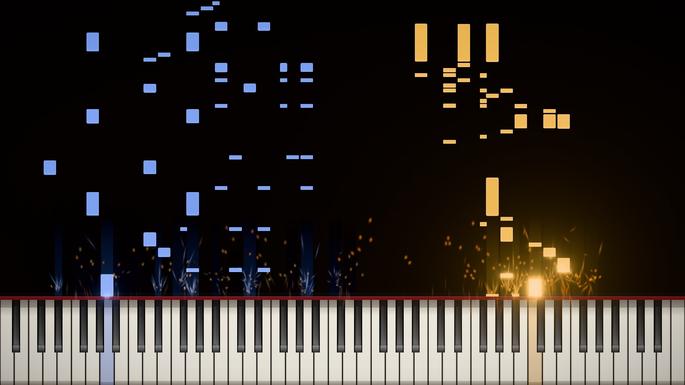
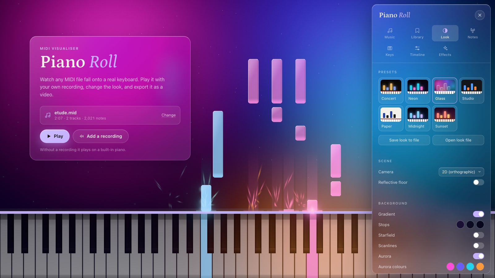
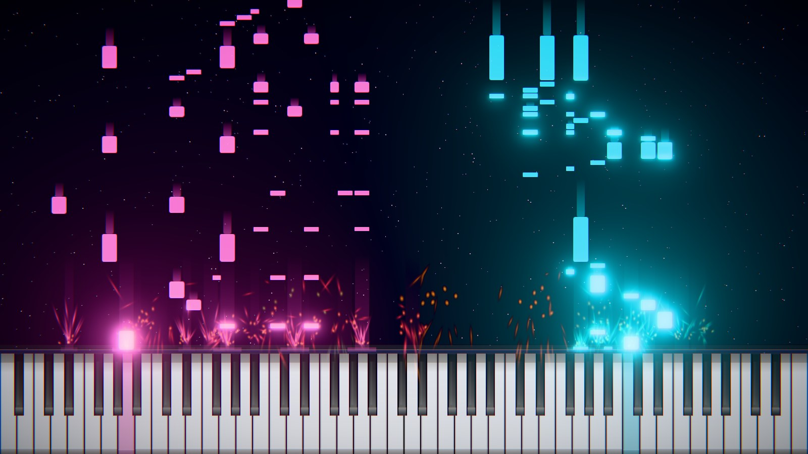
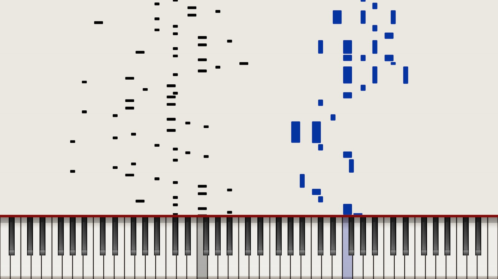
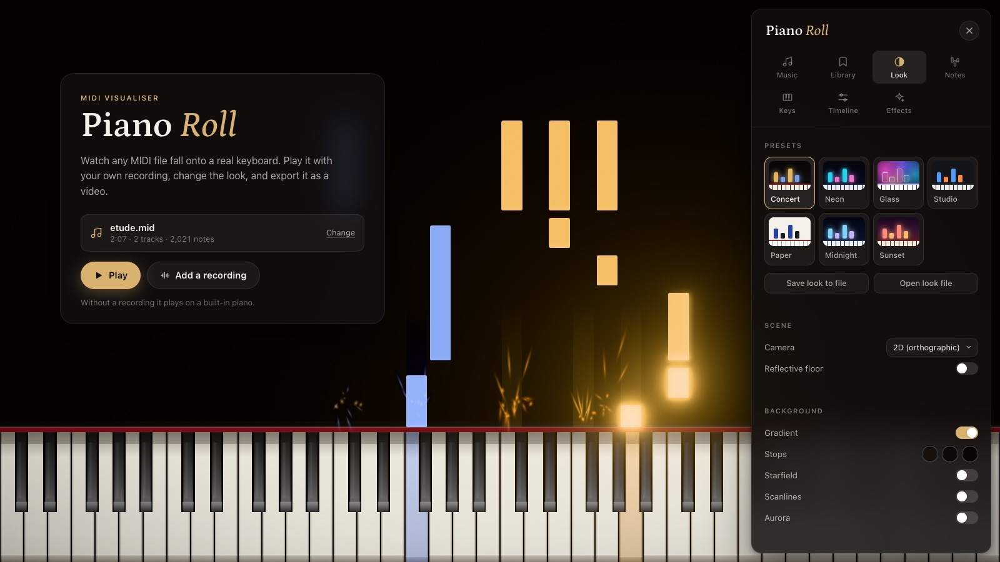
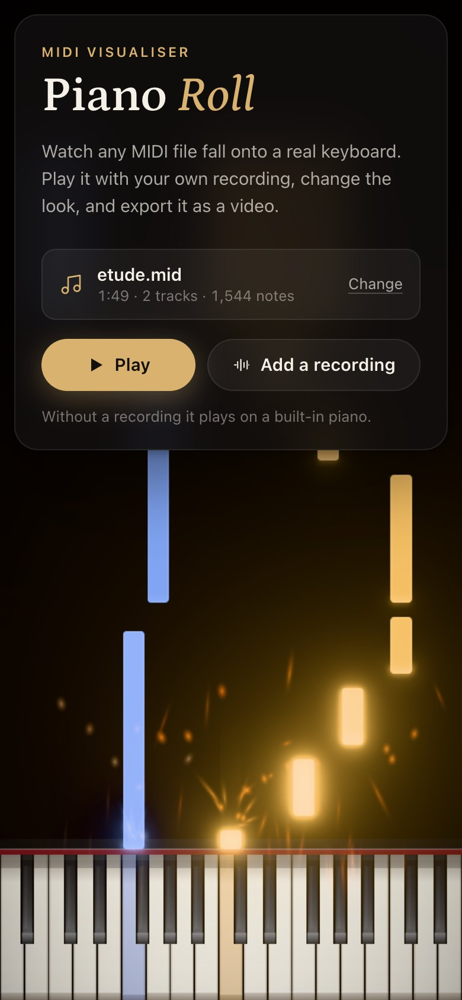

# Piano Roll

A MIDI visualiser that runs in the browser. Notes fall onto a keyboard drawn like a real piano, your own recording plays in sync (or a built-in piano if you don't have one), and the result exports as an MP4.

**Try it:** [worldwiderad.github.io/pianoroll](https://worldwiderad.github.io/pianoroll/)



## Looks

Seven presets, and nearly everything in them can be changed live. Every preset uses the same realistic keyboard shape. The bloom is tuned to catch only the notes, beams and particles, so the keys never wash out.



**Glass** is real frosted glass, not just transparency: each frame the background is drawn on its own and blurred, and the notes and keys show that blur through them, bent slightly at the edges like a lens, with a lit rim along the top and left. White keys are milky glass, black keys smoked glass, and the panels frost over the same moving aurora.

| Neon | Paper |
|---|---|
|  |  |

- **Concert** (the default): a warm dark stage, red felt, amber and blue for the two hands
- **Neon**: saturated light, trails and sparks over near-black
- **Glass**: frosted glass notes, keys and panels over slow-moving colour
- **Studio**: flat and exact, with distinct track colours and a beat grid
- **Paper**: ink on paper
- **Midnight** and **Sunset**

## Using it



1. Choose or drop a `.mid` file.
2. Optionally add a recording (`.mp3`, `.wav` or `.ogg`) to play in sync.
3. Press **Play**. `Space` plays and pauses, the arrow keys skip 5 seconds, and `V` switches to the 3D view.

The keyboard frames itself to the piece's range by default, so a melody gets big keys instead of a sliver of an 88-key piano. *All 88 keys* is one setting away.



It works on a phone too: the panels become bottom sheets and the transport shrinks to what fits.

## What else it does

- **Keyboard**: shaded ivory and ebony keys, off-centre black keys as on a real piano, black-key shadows, a felt strip, and keys that dip and take the note's colour when played
- **Notes**: per-track or per-pitch colours, rounded or capsule shapes, an edge highlight, frosted glass, trails, velocity-driven brightness and afterglow
- **Background**: a gradient, a moving aurora in four colours of your choice, stars, or your own image or video
- **Effects**: bloom, sparks and embers, a drifting dust layer, an optional hit flash, frost, vignette, film grain and chromatic aberration
- **Sound**: your recording, or a SoundFont sampler with piano, strings, brass, woodwinds, synth pad, synth lead and drums per track
- **Timeline**: keyframe track opacity and the 3D camera over the course of a piece
- **Export**: MP4 through WebCodecs, rendered frame by frame at up to 4K and 60 fps (needs a browser with `VideoEncoder`, such as Chrome or Edge)
- **Library**: projects and looks saved in the browser (IndexedDB), and looks can be saved to and opened from a file

[FEATURES.md](FEATURES.md) goes through every setting.

## Running it locally

```sh
npm install
npm run dev
```

Then open http://localhost:5173. Built with TypeScript, Three.js and Vite; no backend, and files never leave your machine.

`3d-preview/3d-early-prototype.html` is the single-file prototype the app grew out of.
